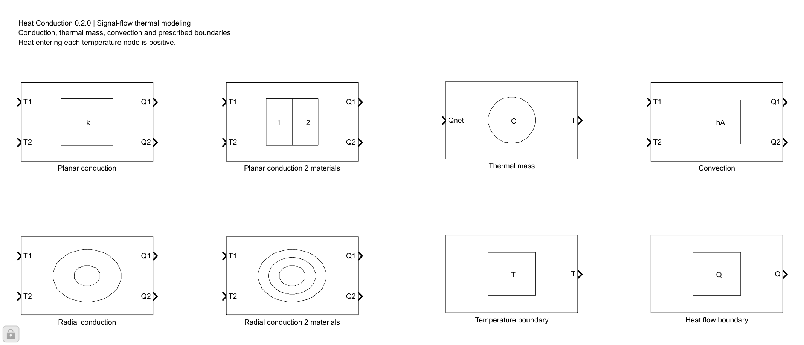
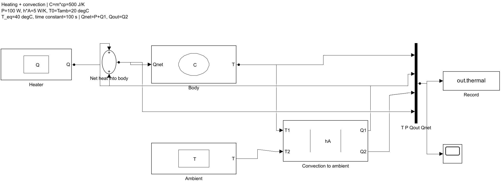
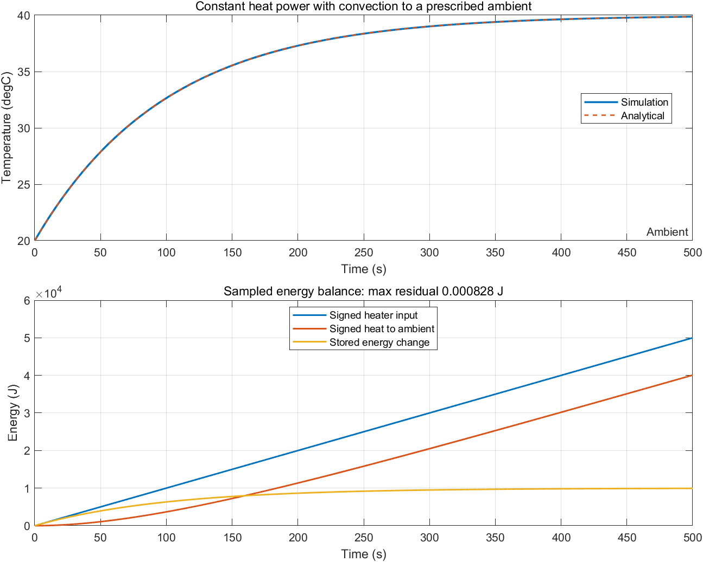
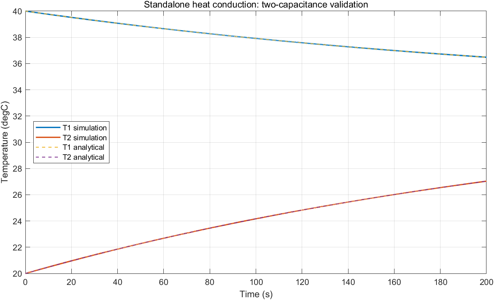

# Simulink Heat Conduction

[中文](README.md) | English

A source-rebuildable library for conduction and lumped thermal networks using ordinary Simulink signals.

**Version 0.2.0 · MATLAB/Simulink R2023a · MIT License**



## Elements

| Element | Application | Total resistance R [K/W] |
|---|---|---|
| Planar conduction | One planar material | `distance/(lambda*area)` |
| Planar conduction 2 materials | Two planar materials with optional contact resistance | `distance1/(lambda1*area)+distance2/(lambda2*area)+ctr` |
| Radial conduction | One coaxial cylindrical shell | `log(diamExt/diamInt)/(2*pi*lambda*le)` |
| Radial conduction 2 materials | Two coaxial shells with optional contact resistance | `log(diamCt/diamInt)/(2*pi*lambda1*le)+log(diamExt/diamCt)/(2*pi*lambda2*le)+ctr` |

Elements use ordinary Simulink arithmetic blocks, sources and integrators. Both ready-to-open `.slx` files and editable `.m` build sources are included.

## New in v0.2.0

The four original conduction block paths, parameters and ports remain compatible.

| New element | Ports | Relationship |
|---|---|---|
| Thermal mass | Qnet [W] in, T out | `dT/dt=Qnet/(mass*cp)`, initialized at Tinit |
| Convection | T1/T2 in, Q1/Q2 [W] out | `Q1=h*area*(T2-T1)`, `Q2=-Q1` |
| Temperature boundary | T out | Constant prescribed reservoir temperature |
| Heat flow boundary | Q [W] out | Constant signed heat power: positive heats, negative removes heat |

Thermal mass uses a **continuous Integrator** and requires a continuous-state solver such as ode4 or ode45. Do not use FixedStepDiscrete in a model containing this new block. The original discrete example remains available.

Mass is in kg, specific heat in J/(kg K), h in W/(m^2 K), and area in m^2. Sum incoming heat flows before the Qnet input. h=0 represents an adiabatic path. The convection block does not calculate fluid flow or estimate h.

Connect a temperature boundary to one side of a conduction/convection element. It represents an ideal reservoir without an independently integrated temperature. Heat flow boundary specifies total power, not heat flux density; multiply W/m^2 by area first. Standard Simulink sources can supply time-varying temperature or power signals.

## Requirements

- MATLAB and Simulink. Prebuilt models and verification use **R2023a**. Other releases have not been tested. Rebuilding from source may be an option for older releases, but compatibility is not guaranteed.
- No Simscape or third-party thermal library is required. A MATLAB/Simulink license is still required.
- Parameters are finite real scalars. Conductivities, heat capacities and heat transfer coefficients are constant within a simulation in this release.

## Quick start

Download or clone this repository and set the MATLAB current folder to its root:

```matlab
setup_shc
```

Open `SHCLib`, or find **Heat Conduction** in the Library Browser and drag elements into your model. Setup modifies only the current MATLAB session path; it does not call `savepath`.
After an update, close any old SHCLib loaded in memory before running setup again; first save desired library edits to a separate backup.

```matlab
% Constant heating with convection to a prescribed ambient
setup_shc(false)
result = run_shc_heating_demo;

% Original regression checks plus all new checks
report = test_shc_all;

% Original v0.1.0 example
legacy = run_shc_demo;
```

The new `examples/shc_heating_cooling.slx` model includes its solver and model-workspace parameters; no base-workspace initialization is required. Rebuild it with `build_shc_heating_demo`.

Defaults: mass=0.5 kg, cp=1000 J/(kg K), heat power=100 W, h=10 W/(m^2 K), area=0.5 m^2, and initial/ambient temperatures=20 degC. The equilibrium temperature is 40 degC and the time constant is 100 s. The model runs for 500 s with ode4 and a 0.1 s step.





Results include temperature, the analytical solution, signed heat flows and the energy balance. Cumulative heat is computed after simulation using sampled trapezoidal integration, so the residual includes sampling/integration error. A reusable energy-monitor library block is outside this release's scope.

```matlab
cooling = run_shc_heating_demo(true, struct('power',0,'Tinit',60));
adiabatic = run_shc_heating_demo(true, struct('h',0));
```

Parameter overrides do not modify the saved model or require base-workspace variables.

The example `examples/shc_two_masses.slx` connects capacitances of 1000 and 500 J/K, initially at 40 and 20 degC, through a resistance of 0.8 K/W. The equilibrium temperature is 33.3333 degC and the time constant is 266.6667 s. The simulation runs for 200 s with a 0.01 s fixed step.



The original **24 regression checks** are retained. The original example's maximum analytical temperature error is 8.86e-5 degC and its relative energy variation is 9.02e-15. See [v0.2.0 verification](docs/VALIDATION_v0.2.0.md); the [v0.1.0 record](docs/VALIDATION.md) remains available.

**All 61 v0.2.0 checks passed in R2023a (24 regression + 37 new).** The new heating example has a maximum analytical temperature error of 1.49e-13 degC and a sampled energy residual of 8.28e-4 J (relative error 1.66e-8).

## Ports and signs

```text
Inputs:  T1, T2 — temperatures [degC or K, use the same scale]
Outputs: Q1, Q2 — heat entering the corresponding node [W]

Q1 = (T2 - T1) / R
Q2 = -Q1
```

For T1=40 degC and T2=20 degC, Q1 is negative and Q2 is positive. Include Q1 in the net heat input of node 1 and Q2 in that of node 2. Update each node temperature using `dT/dt=Qnet/(m*cp)`.

For radial elements, T1 is the inner temperature and T2 is the outer temperature. Ports are directed Simulink signals and cannot connect directly to Simscape thermal conserving ports.

Conduction and convection elements do not store heat. Use external Thermal mass nodes or your own storage equations for transient models.

## Geometry and contact resistance

- Conductivity `lambda`: W/(m K); distances, lengths and diameters: m; `area`: m^2; `ctr`: K/W.
- Planar distances refer to the actual locations of temperature nodes. In two-material elements, each distance is from its node to the interface. Cell-centered discretizations commonly use half-cell distances.
- Cylindrical equations describe one-dimensional radial conduction through coaxial shells. Diameters must be strictly increasing and the inner diameter must be positive. Side-by-side cylinder contact, a control volume containing the axis, and axial conduction require their corresponding models.
- `ctr` is **total contact resistance**. Convert area-specific resistance R'' [m^2 K/W] using `ctr=R''/area` for planar interfaces or `ctr=R''/(pi*diamCt*le)` for cylindrical interfaces.
- Defaults are illustrative. Use application-specific geometry and properties, and verify spatial discretization, time step and boundary conditions.

## Rebuild from source

Save any desired changes and close the loaded `SHCLib` before rebuilding:

```matlab
setup_shc(false)
build_shc_library
```

`src/shc_block_specs.m` defines conduction elements. `src/shc_thermal_specs.m` and `src/shc_add_thermal_element.m` define/build the four new elements. `src/build_shc_library.m` creates `library/SHCLib.slx`. Rebuilding replaces this project's library file without editing unrelated models.

## Project layout

```text
library/     SHCLib.slx and Library Browser registration
src/         Editable element definitions and builder
examples/    Two-capacitance model, builder and runner
tests/       Numerical and dependency checks
docs/        Previews, validation record and publishing notes
setup_shc.m  Session setup entry point
LICENSE      MIT License
```

## Implementation and license

This project independently constructs an explicit temperature/heat-flow signal network from standard planar, cylindrical and series-resistance equations. It does not bundle a third-party commercial thermal library, protected P-code, third-party library links, or a replacement license-check function.

Project sources, models and documentation are provided under the [MIT License](LICENSE). MathWorks retains the rights to MATLAB, Simulink and their built-in components; their licensing is outside the scope of this project's MIT grant.

Equation reference: [MathWorks — Conductive Heat Transfer](https://www.mathworks.com/help/simscape/ref/conductiveheattransfer.html). Library registration reference: [MathWorks — Add Libraries to Library Browser](https://www.mathworks.com/help/simulink/ug/adding-libraries-to-the-library-browser.html).

Repository: [hwx20040317/simulink-heat-conduction](https://github.com/hwx20040317/simulink-heat-conduction).
